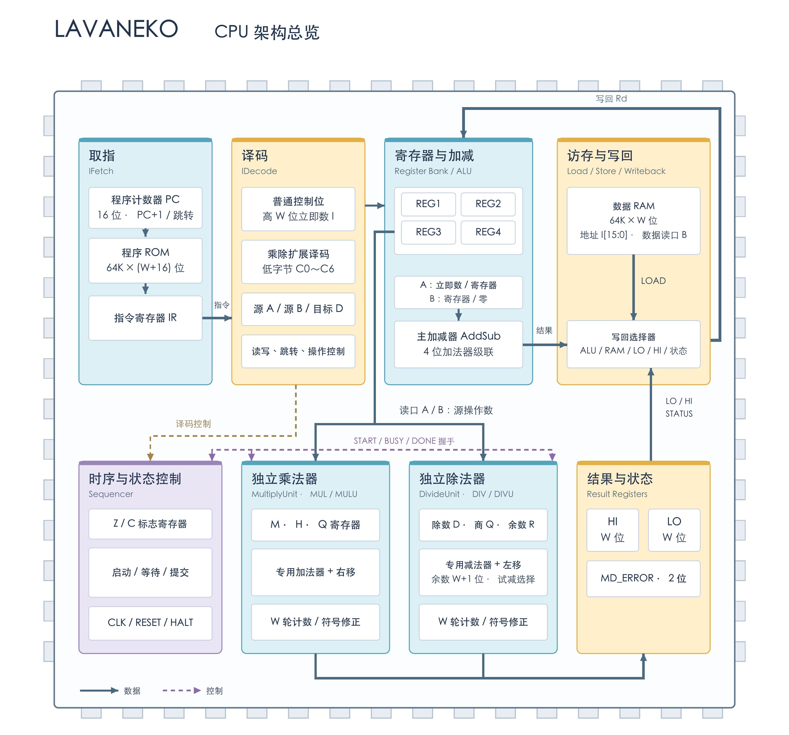

# Lavaneko

用 Logisim-evolution 重建的 CPU 项目。以你提供的旧架构截图为依据，保留四个寄存器、加减运算、ROM 控制、可跳转 PC、独立 RAM 和共享写回通路，并加入独立的硬件乘除单元。默认使用 16 位数据通路，同时提供 32 位版本。

截图没有包含原始子电路和完整指令定义，所以这是能运行、能继续修改的重建版。补充的指令编码和时序在 [架构说明](docs/architecture.md) 中明确记录。

## 架构总览



[可编辑矢量图](docs/Lavaneko-架构总览.svg) · [架构与指令集 PDF](docs/Lavaneko-架构与指令集.pdf)

## 打开并运行

已安装的应用为 `/Applications/Logisim-evolution.app`，版本 5.0.0，Apple Silicon 官方版本。

直接打开 [16 位电路](logisim/projects/Lavaneko16.circ)，或在项目目录执行：

```sh
npm run open
```

32 位版本用 `npm run open:32` 打开。选中左侧 `Lavaneko` 总电路后：

1. 点击 `RESET` 按钮复位。
2. 使用 `Simulate → Manual Tick Full Cycle` 推进完整时钟周期；或者按 `⌘K` 开启自动时钟。
3. `⌘T` 只推进半个周期：上升沿取指，下降沿执行；乘除指令会占用多个周期。
4. 演示程序最终停在 PC=`002F`，REG1=`0007`、REG2=`FFFD`、REG3=`FFFE`、REG4=`0001`，HI=`0001`、LO=`FFFE`、MD_ERROR=`0`、BUSY=`0`，`halt=1`。输出以十六进制显示。
5. 停止自动时钟后再次复位，可以重新执行。双击子电路查看内部结构。

演示程序先算 10+3 和 13−3，再测试 RAM 存取、条件跳转和循环求 5+4+3+2+1。随后演示有符号/无符号乘除、读取高低结果、除零和有符号除法溢出，最后执行 7÷(-3)，商为 -2、余数为 1。原来的 21 条指令示例保留在 `toolchain/programs/legacy16.hex` 和 `legacy32.hex`。四个寄存器均可按编号选择读写，不会自动轮换。

## Monorepo

```text
cpu/
  isa/              指令编码与架构参考模型
  hardware/         实体 CPU、器件、PCB 与板间接口资料
docs/               架构说明、指令集 PDF、架构图和参考截图
logisim/
  circuits/         电路生成器源码
  cli/              电路构建与验证命令
  projects/         可直接打开的 16/32 位 .circ 工程
  verification/     Logisim 原生仿真测试向量
toolchain/
  compiler/         C → 汇编（预留）
  assembler/        汇编 → 目标文件（预留）
  linker/           目标文件 → 程序二进制（预留）
  programs/         现有 ROM 镜像及演示程序
emulator/           Go 指令集模拟器（预留）
studio/             Wails 桌面应用与 Vue 前端（预留）
tools/              仓库级辅助工具
```

依赖方向：`logisim/cli → logisim/circuits → cpu/isa`。跨包只能引用各包公开入口，内部 `lib/` 不对外开放。已配置 dependency-cruiser 边界检查，并验证非法跨包导入会被拒绝。

完整职责与后续模块接入规则见 [模块边界](docs/modules.md)。所有目录共用根 Git 仓库，现有 JavaScript 包由根 Bun workspace 和锁文件统一管理。

```sh
bun install
npm run build
npm run check
```

`build` 会重新生成两份 `.circ`、ROM 镜像和测试向量。它会覆盖生成文件；需要保留手动编辑的电路时，请先在 Logisim 中另存副本。要可重复地修改架构，请编辑 `logisim/circuits`；修改编码及演示程序请编辑 `cpu/isa`，随后重新生成。

`check` 包含格式检查、包边界检查、参考模型测试和 Logisim 原生仿真。其他机器可以用 `LOGISIM_EXECUTABLE` 指定 Logisim 可执行文件路径。

## 当前范围

16 位加减器由四个 4 位加法器串联，32 位版本使用八个；减法通过补码运算复用加法器。独立乘法器使用移位累加，独立除法器使用移位试减与余数选择，均支持有符号和无符号模式，不占用主 ALU。16 位正常乘除需要 18 个执行周期，32 位需要 34 个；除零和有符号溢出用 2 个周期返回状态。尚未加入独立移位指令、中断或栈机制。

这里的寄存器、存储器和选择器是 Logisim 功能模型。后续还需要映射到实际 74 系列器件，核算封装、供电、时序和板间连接，才能制作 PCB。

## 仓库

项目仓库：[lavamilkTeam/lavanekoCPU](https://github.com/lavamilkTeam/lavanekoCPU)。所有模块在同一仓库中维护。
