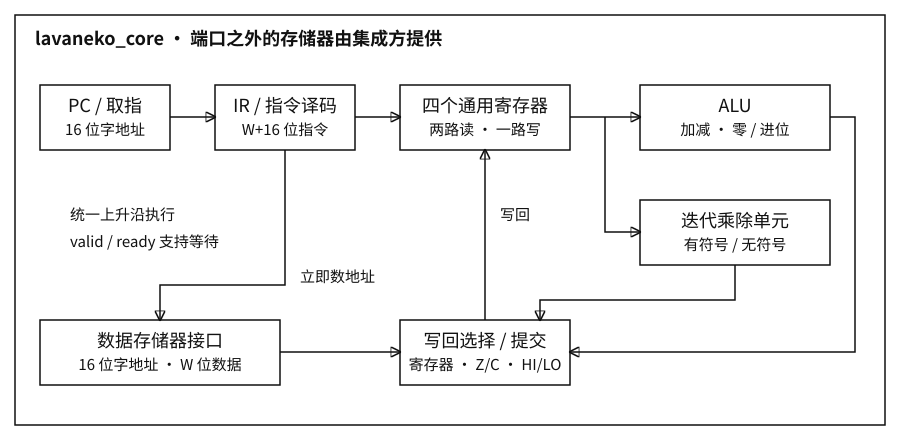

milku

# 架构

并行入口已实现 **4 核心 × 16 lane**，见 [并行计算核心](gpu.md)。下文记录保留的标量兼容核心及基础 R32 指令集。

当前指令版本：**Milku R32 v1**。32 个 32 位通用寄存器，32 位定长指令，自定义编码，不兼容 RISC-V 或旧 Lavaneko 机器码。

旧四寄存器兼容版保存在提交 `6f8f281feb20bf7dffcbe6b3b23a5be1b4895cc0`。本版本沿用其加减和迭代乘除单元，重新定义指令编码及解码。



| 项目 | 当前实现 |
|---|---|
| 数据与指令宽度 | 均为 32 位；核心不再提供 16 位配置 |
| 通用寄存器 | R0..R31，编号 0..31；全部可写，包括 R0 |
| 寄存器组 | 两路组合读，一路同步写；复位清零全部 32 个 |
| PC | 16 位指令字地址；每条指令 PC+1，65535 后回绕 |
| 数据地址 | 16 位数据字地址；每字 32 位；可访问 256 KiB |
| 标志 | Z 零标志；C 加法进位／减法无借位 |
| 乘除状态 | HI、LO 各 32 位；MD_ERROR 两位 |
| 执行 | 单发射、顺序提交；该标量入口不包含 SIMD；并行入口见 gpu.md |
| 复位 | 高有效，同步上升沿；外部存储器不随核心自动清零 |

## 编码

R 格式：`opcode[6] | Rd[5] | Ra[5] | Rb[5] | 0[11]`。
I 格式：`opcode[6] | Rd/Rs[5] | Ra[5] | imm16[16]`。
J 格式：`opcode[6] | 0[10] | target16[16]`。

LDI、LUI 不使用 Ra；MFLO、MFHI、MDSTAT 只使用 Rd；CMP 不写 Rd；NOP、HALT 不使用操作数字段。不使用的字段应填零，硬件忽略它们。操作码 20..63 保留为 NOP，不写寄存器、标志或存储器。

## 指令

| 操作码 | 二进制 | 格式 | 指令 | 操作 |
|---|---|---|---|---|
| 00 | 000000 | R | NOP | PC+1 |
| 01 | 000001 | I | LDI Rd, imm16 | 符号扩展立即数至 32 位 |
| 02 | 000010 | I | LUI Rd, imm16 | Rd=imm16<<16，低 16 位清零 |
| 03 | 000011 | I | ORI Rd, Ra, imm16 | Ra 与零扩展立即数按位或 |
| 04 | 000100 | I | ADDI Rd, Ra, imm16 | Ra 加符号扩展立即数；更新 Z/C |
| 05 | 000101 | R | ADD Rd, Ra, Rb | 加法；更新 Z/C |
| 06 | 000110 | R | SUB Rd, Ra, Rb | 减法；更新 Z/C |
| 07 | 000111 | R | CMP Ra, Rb | 相减只更新 Z/C |
| 08 | 001000 | I | LOAD Rd, [Ra+imm16] | 从地址读取一个 32 位数据字 |
| 09 | 001001 | I | STORE Rs, [Ra+imm16] | 将 Rs 写入地址；Rs 占 25:21 |
| 0A | 001010 | J | JUMP target16 | 无条件跳转 |
| 0B | 001011 | J | JZ target16 | Z=1 时跳转，否则 PC+1 |
| 0C | 001100 | R | HALT | 停止，PC 保持 |
| 0D | 001101 | R | MULU Rd, Ra, Rb | 无符号乘积写 HI:LO，Rd=LO |
| 0E | 001110 | R | MUL Rd, Ra, Rb | 有符号乘积写 HI:LO，Rd=LO |
| 0F | 001111 | R | DIVU Rd, Ra, Rb | 无符号商写 LO，余数写 HI，Rd=LO |
| 10 | 010000 | R | DIV Rd, Ra, Rb | 有符号除法，结果布局同上 |
| 11 | 010001 | R | MFLO Rd | 读取 LO |
| 12 | 010010 | R | MFHI Rd | 读取 HI |
| 13 | 010011 | R | MDSTAT Rd | 零扩展 MD_ERROR |

只有 ADDI、ADD、SUB、CMP 更新 Z/C。其余指令保持标志。不存在通用有符号溢出标志。

## 立即数与地址

LDI、ADDI、LOAD、STORE 的 imm16 符号扩展；ORI 零扩展；LUI 直接使用其 16 位位模式。装入任意 32 位常数：

```text
LUI R31, 0x1234
ORI R31, R31, 0xABCD     → R31=0x1234ABCD
```

访存地址为 `(Ra + sign_extend(imm16)) & 0xFFFF`，单位为 32 位数据字；越界按低 16 位回绕，当前没有地址异常。STORE 的第二读取端口选择 Rs 字段，不能误把立即数的 15:11 当作寄存器编号。

## 模块与时序

核心 `rtl/lavaneko_core.v` 只通过公开端口调用 `lavaneko_regfile`、`lavaneko_alu`、`lavaneko_muldiv`。生产清单是 `rtl/files.f`；测试与存储器模型不进入核心综合。

- 无等待普通指令：2 拍，取指、执行提交。
- LOAD/STORE：3 拍，增加数据握手提交。
- 正常乘除：36 拍，取指一拍、单元运算 34 拍、提交一拍。
- 错误除法：4 拍。外部 ready 等待另计。

单元内部按移位累加／试减迭代，不用主 ALU。有符号除法朝零截断，余数符号与被除数相同。成功时 MD_ERROR=0；除零为 1，MIN/-1 为 2。错误时保持目标寄存器，HI=LO=0，PC 前进；Z/C 保持。

统一上升沿时序。复位撤销未完成请求，但不撤销已经完成的外部写入；外部存储器适配器须协同复位。无字节使能、异常向量、中断、缓存或虚拟内存。
