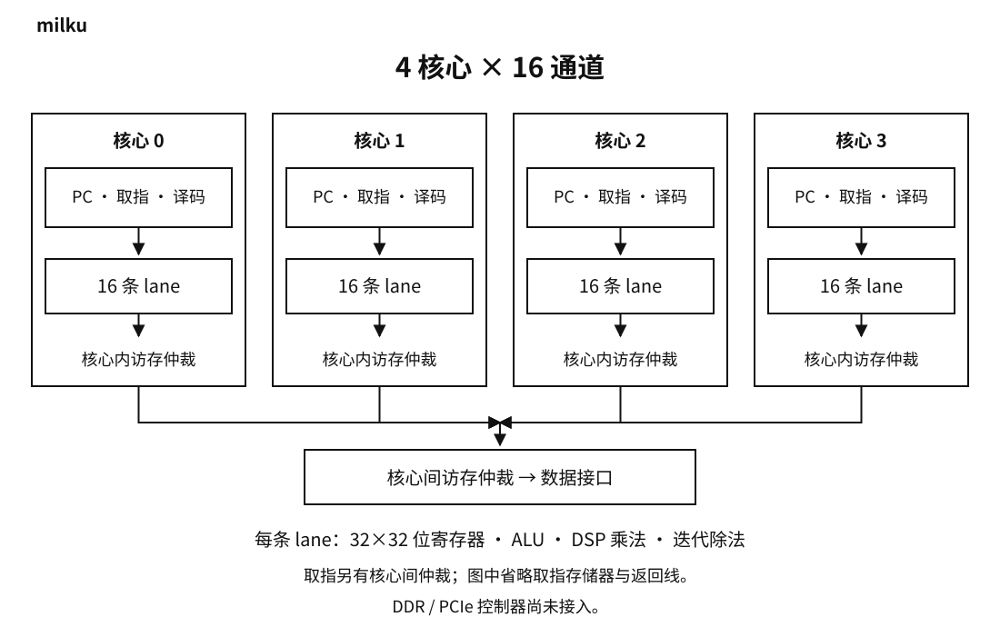

milku

# 并行计算核心

`milku_gpu` 默认 **4 个核心 × 16 条 lane**。每核心独立 PC、指令寄存器、译码和执行掩码；同核心各 lane 执行同一条指令。每条 lane 有独立的 32×32 位通用寄存器、ALU、DSP 乘法与迭代除法单元、Z/C、HI/LO 和错误状态。



| 模块 | 负责 | 依赖 |
|---|---|---|
| `milku_gpu` | 各核心启动、状态汇总、指令与数据接口仲裁 | `milku_simd_core`、`milku_arbiter` |
| `milku_simd_core` | 取指、共享译码、广播、等待、统一分支、退休事件 | `milku_lane`、`milku_arbiter` |
| `milku_lane` | 独立运算状态、执行、访存请求和寄存器写回 | 原有寄存器组、ALU、DSP 乘除模块 |
| `milku_dsp_muldiv` | DSP 乘法、迭代除法、结果握手 | 无 |
| `milku_arbiter` | 轮转服务请求，锁定等待中的所有者，分发完成信号 | 无 |

所有跨模块连接通过端口。旧 `lavaneko_core` 保留为单通道兼容入口；不使用 64 个完整标量核心模拟 lane。

基础标量实现基线为 `d38ffa90bccb2490d732bc2a17c7563ddfe8697d`；并行源码入口为 [milku_gpu.v](../rtl/milku_gpu.v)，本次验证的源码校验值见 [验证记录](gpu-validation.md)。

## 指令

并行入口使用 **R32 SIMD v1**：保留 [R32 v1 的 20 条指令及编码](architecture.md#指令)，增加 3 条读取身份信息的指令。R0 仍然可写。基础算术、符号扩展、乘除错误、HI/LO、访存回绕语义不变。

| 操作码（十六进制） | 32 位编码 | 指令 | 操作 |
|---|---|---|---|
| 14 | `010100 ddddd 00000 0000000000000000` | LANEID Rd | 当前核心内通道编号，默认 0～15 |
| 15 | `010101 ddddd 00000 0000000000000000` | COREID Rd | 核心编号，默认 0～3 |
| 16 | `010110 ddddd 00000 0000000000000000` | TASKID Rd | 启动时的 task_base + 通道编号，按 32 位回绕 |

`ddddd` 是目的寄存器编号；其他字段忽略，规范编码填零。这三条指令不改变 Z/C 或乘除状态。并行入口的操作码 23～63 为 NOP；旧标量入口仍把 20～63 当作 NOP。程序必须选择对应的执行入口，不能混淆两个 ISA 版本。

```text
TASKID R0              每条 lane 获取自己的元素编号
LOAD   R1, [R0+0]      读 A[i]
LOAD   R2, [R0+1024]   读 B[i]
ADD    R3, R1, R2
STORE  R3, [R0+2048]   写 C[i]
HALT
```

主机给核心 0～3 的 task_base 分别为 0、16、32、48，活动掩码均为 0xFFFF，即处理元素 0～63。下一批给 64、80、96、112。当前没有自动分批调度器或汇编器。

## 乘除实现

每 lane 的 `milku_dsp_muldiv` 将输入扩展为有符号 33 位，统一处理 32 位有符号和无符号乘法，取完整乘积低 64 位写 HI:LO。乘法表达式标记 `use_dsp=yes`，Vivado 实测每 lane 使用 4 个 DSP48E1，4×16 共 256 个；它们组合完成一次完整 32 位乘法。

| 单元操作 | 从接收输入沿到结果有效，含接收沿 |
|---|---:|
| 乘法 | 3 拍 |
| 正常除法 | 34 拍 |
| 除零、MIN/-1 | 2 拍 |

单元同一时间只接收一个请求，结果保持到消费握手；3 拍延迟不代表每拍可接收一个乘法。核心还有取指、广播、完成汇总和提交开销。标量兼容入口继续使用原有迭代乘除单元。

## 执行与分支

```text
接受启动 → 清空各 lane 状态 → 取指 → 广播 → 各 lane 执行
                                                   ↓
                    下一条 ← 统一提交 ← 所有活动 lane 完成
```

- 每核心同一时间只有一条指令在执行；已完成 lane 不会重复执行、重复写入。正常乘除与除零可能不同时间完成，完成位图统一等待。
- 掩码在启动时锁存。关闭的 lane 不执行、不发起访存、不修改状态、不参与完成判断；掩码全零直接完成。
- `JUMP` 更新核心共享 PC。`JZ` 只检查活动 lane：Z 全为 1 则跳转，全为 0 则顺序执行；混合时置 fault 并停止此核心，PC 保留在 JZ。该 JZ 不产生退休事件，其他核心继续运行。
- `HALT` 完成整个核心任务。done 持续到下一次启动或复位；fault 持续到下一次启动或复位。
- 不支持分支分歧后的分批执行、线程切换、跨核心屏障或原子操作。

## 存储

保留 R32 的 **16 位字地址、32 位数据**。PC+1 是下一条 32 位指令；数据地址为 `(Ra + sign_extend(imm16)) & 0xFFFF`。两个地址空间各 256 KiB。DDR 的更大物理容量不会自动扩展这个寻址范围。

每核心的 lane 请求经过轮转仲裁，再与其他核心的数据请求仲裁。等待时所有者不变；只有服务中的 lane 收到完成信号。读回数据只在该 lane 的握手完成沿写回。

指令和数据是两套独立外部接口，各最多一个未完成事务，可同时工作。当前数据接口整体一次只完成一个 32 位读写；没有缓存、访存合并或突发。不同 lane 向同一地址写入会依次执行，程序不应依赖跨核心竞争顺序；不提供原子读改写。

## 验证范围

- 2×16 与 4×16：各核心不同程序入口、各 lane 独立数学模型、全部寄存器读索引、23 条指令、保留操作码、乘除边界、随机等待、关闭部分 lane、任务重启与完整存储内容检查。
- 控制：分支分歧隔离、统一跳转、零掩码、忙时启动拒绝、等待取指/写入/除法时复位，以及乘法单元执行中复位、PC 回绕。
- [Vivado 资源和时序](gpu-validation.md)：针对 XC7A200T FBG484 -2 的独立计算模块验证；不包含 DDR、PCIe 和板级引脚。

## 限制

尚无浮点、完整 SIMT 分歧恢复、图形流水线、DDR/MIG 适配、PCIe/DMA、驱动或 Unity 支持。寄存器组仍使用可复位寄存器实现，没有改成块 RAM；乘法使用 DSP，多周期除法仍使用逻辑实现。配置参数是硬件生成参数，不是运行时调整开关。
